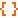

Satyam Tripathi is the founder of [Doccraft](https://doccraft.dev). His [articles](https://github.com/triposat/published-blogs) appear on Bright Data, Apify, ScrapingBee, GoLogin and Evomi.

## Focus areas

 &nbsp;[Web scraping APIs and proxies](https://doccraft.dev/topics/web-scraping-apis-and-proxies) 
 &nbsp;[Browser infrastructure and automation](https://doccraft.dev/topics/browser-infrastructure-and-automation) 
 &nbsp;[Web search and data APIs for AI agents](https://doccraft.dev/topics/web-search-and-data-apis-for-ai-agents) 
 &nbsp;[Data extraction and structured data](https://doccraft.dev/topics/data-extraction-and-structured-data) 
 &nbsp;[RAG and retrieval pipelines](https://doccraft.dev/topics/rag-and-retrieval-pipelines)

## Work

 &nbsp;[Original research and benchmarks](https://doccraft.dev/blog), with the data and code
